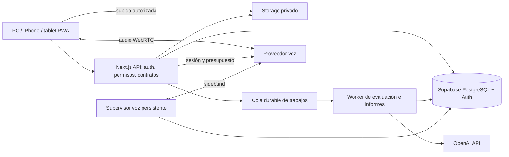

# Arquitectura propuesta

Estado: pendiente de aprobación, sin recursos cloud creados. Fuentes técnicas T01–T14 en [registro](../research/SOURCES.md). Las comparaciones siguientes son juicio de diseño, no benchmarks de rendimiento realizados.

## Stack y alternativas

| Solución solicitada | Alternativa | Ventajas alternativa | Inconvenientes | Recomendación |
|---|---|---|---|---|
| Next.js/React/TypeScript | React/Vite + API separada | Cliente simple y backend independiente | Dos despliegues desde el principio; más integración auth | Next.js modular; no hace falta SSR para todos los labs |
| Supabase PostgreSQL/Auth/Storage | Firebase | SDK integrado y sincronización cliente | Modelo documental menos natural para evidencia relacional; otro régimen de permisos | Supabase por relaciones, SQL y RLS; estudiar salida mediante exportaciones |
| Vercel | Contenedor Node en hosting gestionado | Proceso persistente y control de workers | Más operación, escalado y observabilidad propios | Vercel para web/API; decidir sideband persistente mediante spike |
| OpenAI Realtime WebRTC | Gemini Live native audio | Voz bidireccional alternativa | WebSocket/PCM y nueva validación de calidad/datos | OpenAI principal, adaptador reemplazable |
| Realtime | GPT-Live con backend delegado | Voz y razonamiento desacoplados; tarifa por minuto | Nueva integración; validar controles de examen | Benchmark acotado antes de escoger ruta final de voz |
| PWA | Expo/React Native | Mejor control nativo de audio/interrupciones | App Store y mantenimiento adicional | PWA primero; nativa si prueba física demuestra impedimento importante |

No incorporar microservicios, vector DB ni fine-tuning sin necesidad medida. Versiones estables se fijarán al inicializar tras aprobación; no seleccionar versiones antiguas por memoria.

## Componentes

Supervisor y worker son roles lógicos. Cola en PostgreSQL con leases y dedupe al inicio. Trabajos cortos ejecutables mediante funciones acotadas; trabajos largos/sideband necesitan proceso con duración suficiente. El anuncio T13 de WebSockets beta no garantiza sostener toda entrevista: validar límites efectivos del plan. Si requieren contenedor adicional, presentar coste y ADR antes de contratarlo. No mantener audio a través del handler de Next.js ni fingir que un proceso continuará después de terminar la request.

Módulos previstos: identity, content, study, speaking, assessment, vocabulary, errors, exams, analytics, billing-usage. Reglas de dominio independientes de componentes React; API JSON `/api/v1` con contratos versionados reutilizables desde cliente nativo. Secretos solo servidor. Auth no se delega a instrucciones del modelo.

## Sincronización

PostgreSQL es la verdad. Cada mutación lleva `operation_id` UUID, entidad, revisión base y payload validado. Servidor valida propietario y aplica actualización atómica `WHERE revision=base_revision`; incrementa revisión. `409 conflict` devuelve versión servidor; conservar ambas versiones de borrador y permitir elegir/comparar. No last-write-wins silencioso en Writing.

Eventos append-only (respuestas, turnos, revisiones SRS) tienen clave única por operación para tolerar reintentos. Outbox transaccional enlaza cambios con jobs; actualización Realtime notifica invalidación, nunca sustituye consulta autorizada. Al reconectar, descargar cambios desde cursor servidor y aplicar tombstones; reintentar con backoff/jitter. Caché local por usuario, purgada al logout; no reinyectar datos tras borrado de cuenta.

Reading práctica: persistir respuesta y cursor por pregunta; solo mostrar “guardado” tras ACK. Abrir en otro dispositivo consulta intento y última revisión. Offline: outbox temporal visible; otro dispositivo solo verá lo confirmado en cloud. Corrección a posteriori no cambia tiempo de intento entregado.

Writing: autosave tras pausa breve y periódico (objetivo 2–5 s), journal local y snapshots servidor; no depender de unload. Una pestaña editora con lease reduce conflictos, pero no sustituye control optimista.

Speaking: una sesión activa por usuario salvo excepción explícita; chunks numerados, hash y confirmación de subida. Recuperar conversación a partir de turnos persistidos; una conexión nueva es un segmento nuevo, no continuidad perfecta del proveedor. No prometer recuperar audio que nunca salió del dispositivo si iOS elimina la caché.

## Mock engine

Definición versionada: skill, tareas, orden, duración, ayudas, reglas de replay, pausa y fuentes. Estados `created → running → interrupted/submitted → evaluating → completed`, más `invalidated`. Deadline servidor; cambiar reloj local no concede tiempo. Comandos iniciar/entregar idempotentes. Corte en práctica permite continuar; corte en mock conserva material y marca interrupción, sin pausar reloj salvo política preestablecida. Nunca certificar equivalencia oficial si se alteraron condiciones.

Exam attempts fijan contenido y política al comenzar; feedback y claves solo desde endpoints posteriores al cierre de todas las secciones. Las ayudas no se envían ocultas al navegador. Etiqueta por defecto: “Simulacro de entrenamiento inspirado en STANAG 6001”; perfil español específico solo cuando se verifican convocatoria y especificaciones.

## Administración y contenido

Panel sencillo con rol editor validado en servidor, no SQL libre: formularios por tipo, preview, revisión, publicación y archivo. Rúbricas necesitan revisión explícita y nueva versión; no editar criterios de evaluaciones históricas. Búsqueda PostgreSQL full-text y filtros skill/level/topic/source/type; favoritos privados.

Importaciones futuras: upload privado limitado por tamaño/MIME, análisis antivirus/aislado, extracción asíncrona, OCR opcional con coste explícito, revisión humana y derechos antes de publicación. El archivo es dato no confiable, nunca prompt de sistema. Dedupe mediante hash y metadatos antes de embeddings.

## Incremento operativo de práctica sin servicios (2026-10-29)

Modo personal local explícito, seleccionado por el servidor cuando no existe configuración Supabase. `practiceRequest` conserva el transporte cloud existente y añade un adaptador local separado, nunca un fallback ante fallo de auth. Registros individuales validados/versionados para planes, actividades, muestras entregadas y observaciones; no usa ni modifica claves de recuperación Writing. Es un espacio de invitado del navegador, no un sustituto de la futura cuenta sincronizada. PostgreSQL sigue siendo la fuente de verdad de datos cloud; migrar datos locales requerirá decisión explícita.

`nextPractice` es una regla determinista de selección, no un evaluador: calendario activo, carga declarada por skill, cuatro muestras iniciales y observaciones manuales. Con datos incompletos se ofrece práctica general; no se ascienden niveles, no se cambia la fecha del examen y no se simulan ayudas de IA. Reading se corrige en una ruta local sin estado con las claves existentes. Las pantallas reutilizan los contratos de entrenamiento y Error Bank; el flujo de Writing validado en la rama oficial se conserva intacto.

## Incremento diagnóstico de cuatro destrezas (2026-10-29)

Contratos `Submission` discriminados y versionados para Reading, Writing, Listening y Speaking. Las muestras son inmutables y su entrega usa un ID estable; los borradores Writing diagnósticos usan el parser de recuperación existente con una clave propia por identidad. Se recuperan al montar el editor y se guardan sin debounce en cada edición. La entrega solo cierra la muestra después de una respuesta satisfactoria del adaptador (escritura local confirmada o ACK servidor). Un conflicto no reemplaza el texto. No cambia la sincronización/revisión del Writing Lab.

`practiceIdentity` selecciona invitado sin configuración y verifica la identidad en modo cloud; `DiagnosticBoundary` desmonta el editor/grabador al cambiar cuenta, también entre pestañas mediante eventos de almacenamiento/BroadcastChannel. Los requests cloud del diagnóstico llevan propietario esperado; el servidor lo contrasta con su sesión verificada. Este incremento no implementa sincronización cloud nueva ni migra automáticamente datos de invitado. Pruebas de integración Auth real pendientes.

Listening usa un asset MP3 original estático, no un proveedor de voz. Corrección determinista en el servidor local con claves separadas del bundle cliente; resultado por pregunta/función, transcripción tras entrega y condiciones de práctica. Speaking usa MediaRecorder sin MIME forzado para permitir el formato nativo del navegador, chunks en memoria, blob temporal revocado y cierre de tracks. Cambiar de pestaña marca interrupción; salir revoca el audio. Solo un valor finito de duración del archivo sin interrupciones se guarda: no representa duración de habla ni fluidez. No hay fetch del audio ni serialización del blob.

Resumen y selección diaria leen muestras válidas de versiones conocidas. Historial incompleto o informes sin detalle producen abstención. Siempre `estimatedLevel: null`; un score Reading/Listening no se transforma en SLP. Las cuatro muestras faltantes tienen prioridad, después se señalan errores concretos de la última muestra hasta registrar práctica en esa destreza desde ese día; luego se aplica el reparto del plan, con Listening incluido. Es una regla temporal aproximada, no comprobación de mejora ni replanificación de 36 semanas.

## Recuperación y rotación para uso frecuente

Catálogo público versionado separado de claves y transcripciones de corrección. Selectores por destreza conservan versión en la URL. Los borradores Reading/Listening/Speaking se guardan inmediatamente en almacenamiento local por identidad/versión, se validan antes de restaurarse y bloquean edición obsoleta ante cambios de otra pestaña. No guardan estado del reproductor ni audio; notas Speaking sobreviven, pero tras recargar hace falta grabar de nuevo antes de entregar. No se ha sustituido el editor Writing Lab.

La entrega local confirma el resultado cerrado antes de limpiar la copia pendiente. Reintentos con el mismo ID no duplican muestras; ID con respuestas distintas se rechaza. Exposición a soluciones queda separada y sobrevive al borrado de intentos. Solo se cuenta una primera muestra por material/versionado con trazabilidad suficiente; datos antiguos/desconocidos/repetidos no aumentan evidencia independiente. Esta propiedad describe el historial de material dentro de la aplicación, no independencia certificada frente a fuentes externas ni nivel SLP. La sincronización transaccional de exposiciones en cloud está pendiente y se abstiene allí de acreditar independencia.

Hoy prioriza muestras faltantes, revisión de errores observados sin repaso registrado, tareas abiertas sin entrega y material nuevo dentro del reparto de minutos. Cuando se agota el pequeño banco, ofrece repaso etiquetado; no reprograma 36 semanas ni interpreta repetición como progreso de nivel.

Pruebas de navegador: Playwright Python/unittest con Chromium real y dispositivo de audio sintético, servidor de producción, origen local único, contextos aislados y solicitudes externas del navegador bloqueadas. El runner rechaza configuraciones de servicios presentes antes de arrancar. El runtime de la app sigue siendo Next/TypeScript. QA físico es una lista separada, siempre pendiente hasta disponer de resultados observados.
