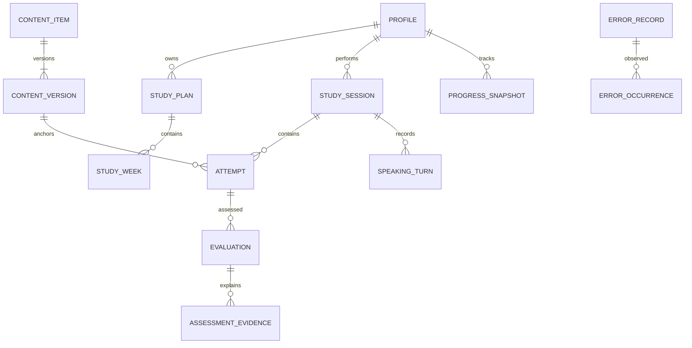

# Esquema lógico v0.1 (no migración ejecutada)

PostgreSQL. UUID para IDs; `timestamptz` UTC; minutos/duraciones no negativos; `revision bigint` en recursos editables. Todas las tablas privadas incluyen `user_id NOT NULL` y FK a perfil; índices compuestos por usuario y fecha. `auth.users` gestionada por Auth; perfil 1:1. No JSON gigantesco por usuario.

| Tabla | Campos principales y relaciones |
|---|---|
| profiles | id FK auth.users, display_name, timezone, exam_date nullable, weekly_minutes, consent_version |
| user_settings | user_id PK, theme, language, audio_retention_days, accessibility |
| declared_slp_profiles | id, user_id, listening/speaking/reading/writing, declared_at, provenance; objetivo separado |
| goals | user_id, target_by_skill, target_date; no sobrescribir declaración inicial |
| study_plans | id, user_id, version, policy_version, basis_snapshot_id, status |
| study_weeks | id, user_id, plan_id, starts_on, allocated_minutes, UNIQUE(plan_id, starts_on) |
| planned_activities | id, user_id, week_id, content_version_id, skill, minutes, reason, locked |
| study_sessions | id, user_id, activity_id nullable, mode, started_at, status, active_seconds |
| study_intervals | id, user_id, session_id, start/end, device_id, event_key UNIQUE; dedupe al agregar |
| sources | id, url, publisher, consulted_at, source_class, access_status, rights, notes |
| content_items | id, owner_id nullable, kind, skill, topic, status, current_version_id |
| content_versions | id, item_id, version, payload JSONB con schema_version, source_id, rights, reviewer, hash; UNIQUE(item_id,version) |
| lessons / exercises | tipos de content_items; payload validado, no tablas duplicadas para cada prompt |
| attempts | id, user_id, session_id, content_version_id, kind, status, cursor, revision, submitted_at |
| attempt_answers | id, user_id, attempt_id, question_id, answer, elapsed_ms, operation_id UNIQUE |
| vocabulary_items | id, user_id, phrase, meaning, collocations, passive_state, active_state, due_at |
| vocabulary_reviews | id, user_id, item_id, recall_type, result, reviewed_at, operation_id UNIQUE |
| vocabulary_usage | id, user_id, item_id, evidence_id, spontaneous, appropriate |
| error_records | id, user_id, category, pattern_key, state, UNIQUE(user_id,category,pattern_key) |
| error_occurrences | id, user_id, error_id, evidence_id, detected_at, validation_state, opportunity_id |
| learning_opportunities | id, user_id, pattern_key, session_id, outcome, help_used; denominador de mejora |
| speaking_sessions | session_id PK, user_id, mode, provider_session_ref, policy_version, recording_consent, integrity |
| speaking_segments | id, user_id, session_id, sequence, connection_state, started_at, interruption_reason |
| speaking_turns | id, user_id, segment_id, role, provider_event_id, start_ms, end_ms, transcript, transcript_version |
| media_assets | id, user_id, session_id nullable, storage_key, mime, bytes, duration_ms, sha256, status, retention_until |
| media_chunks | id, user_id, asset_id, sequence, offset_ms, sha256, storage_key, status; UNIQUE(asset_id,sequence) |
| writing_submissions | attempt_id PK, user_id, current_version_id, exam_mode |
| writing_versions | id, user_id, attempt_id, revision, text, saved_at, parent_id; inmutables |
| reading/listening | attempts.kind + respuestas; métricas específicas derivadas, audio referencia a contenido |
| evaluations | id, user_id, attempt_id/session_id, skill, estimated_level nullable, status, rubric_version, model, prompt_version, input_hash, limitations |
| assessment_evidence | id, user_id, evaluation_id, criterion, finding, supports_or_limits, source_turn/version/answer_id, offsets, confidence_class |
| evaluation_criteria | evaluation_id, criterion_key, status met/partial/not_met/not_observed, evidence_ids; versión esquema |
| mock_definitions | id, version, specification JSONB, source_id, official_alignment_status |
| mock_exams | id, user_id, definition_version, started_at, deadline, integrity, status |
| mock_sections | id, user_id, mock_id, skill, attempt/session_id, deadline, status |
| progress_snapshots | id, user_id, skill, as_of, estimated_level nullable, policy_version, evidence_window, coverage, status |
| snapshot_evidence | user_id, snapshot_id, evidence_id; trazabilidad many-to-many |
| recommendations | id, user_id, snapshot_id, reason, evidence_ids, activity_id, accepted_at |
| reports | id, user_id, period, type, data_snapshot_id, narrative, evidence_ids, version |
| favorites | user_id, content_item_id, UNIQUE(user_id,content_item_id) |
| imports | id, user_id, media_asset_id, status, metadata, extraction_version |
| sync_operations | user_id, operation_id, resource_id, result_revision, expires_at; UNIQUE(user_id,operation_id) |
| change_log | sequence bigint, user_id, entity, entity_id, revision, tombstone, changed_at |
| jobs/outbox | id, user_id, type, dedupe_key UNIQUE, state, lease_until, attempts, next_run_at, payload_ref |
| ai_usage | id, user_id, request_id UNIQUE, model, input/output/cached tokens, seconds, cost_estimated, cost_actual nullable |
| deletion_requests | id, user_id, scope, state, requested_at, completed_at, failures |
| audit_events | id, actor, action, resource_id, timestamp; sin texto/audio/secreto |

## Relaciones e integridad

FK compuestas `(user_id,parent_id)` contra UNIQUE `(user_id,id)` impiden vincular hijo propio a sesión ajena. Referencias polimórficas de evidencia deben implementarse como FKs explícitas opcionales y CHECK exactamente una fuente, no cadenas sin integridad. Evaluación referencia exactamente un intento o sesión. `estimated_level` usa enum ordinal (`below_2`,`2`,`2+`,`3`); NULL para insuficiente, no cero. No guardar perfil como decimal 3.222.

Contenido público solo lectura si publicado; contenido privado/importado exige propietario. Las claves de respuestas deben estar separadas del payload visible de ejercicios (tabla de secretos evaluativos con acceso solo servidor). Intentos fijan versión; borradores nuevos no mutan la historia.

## Permisos e índices

RLS habilitada en toda tabla privada: `auth.uid() = user_id` para lectura y escritura permitida. Evaluaciones, niveles, clocks, consumo y auditoría: cliente no escribe; servidor verifica usuario antes de rol privilegiado. Policies para Storage en bucket privado y rutas con usuario/asset; ruta no basta por sí sola, validar ownership. Roles editor/admin concedidos desde servidor, no metadata editable del usuario.

Índices: `(user_id, created_at DESC)` o fecha equivalente, `(user_id,status)`, `(user_id,due_at)`, `(user_id,skill,as_of DESC)`, `(user_id,session_id,sequence)`. Transacciones para entrega+job, evaluación+evidencias y snapshot+recomendación. No ejecutar LLM dentro de transacción abierta.

Retención/borrado: [seguridad](../architecture/SECURITY.md). Cascada controlada para hijos, borrado de objetos en job durable antes de cierre; no perder lista de claves al borrar padre. Backups y archivos fuera de Git. Migraciones SQL versionadas y tests RLS se crearán solo después de aprobación.

## Implementación disponible: muestras de cuatro destrezas

El esquema extenso anterior sigue siendo diseño objetivo. Las cuatro migraciones en `supabase/migrations/` preparan la base implementada de borradores, planes, actividades, muestras y Error Bank; ninguna se ha aplicado a un servicio externo en este incremento. `202610290004_diagnostic_skills.sql` amplía las condiciones JSON de `diagnostic_submissions` para Listening/Speaking conservando las políticas RLS y la inmutabilidad. No añade columnas, buckets ni objetos de audio.

Cada muestra guarda ID, propietario, fecha y payload con versión. Reading: respuestas; Listening: respuestas, modo práctica, inicios/reanudaciones, finales de reproducción y exposición declarada a transcripción/soluciones. Speaking: realización, ayuda, notas, interrupción, duración fiable opcional y `audioRetained=false`. Writing entregado es texto cerrado. Las rutas rechazan campos de audio y niveles enviados por el cliente; la migración limita a las formas admitidas, las validaciones completas permanecen en los schemas de servidor.

En modo local estos contratos se conservan como registros independientes por identidad en `slp:practice:v1:<identidad>:`. El borrador diagnóstico Writing usa `slp:diagnostic:writing:v1:<identidad>` con ID de entrega estable, estado cerrado y metadatos de recuperación; no reemplaza las claves de Writing Lab. El cierre no implica sincronización cloud. Exportación incluye muestras cerradas, no borradores ni audio. No hay importación automática entre identidades.
